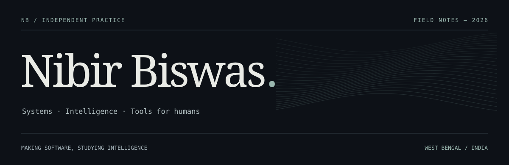
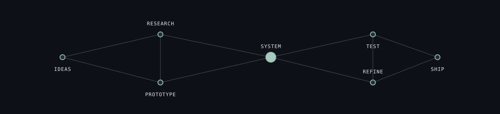
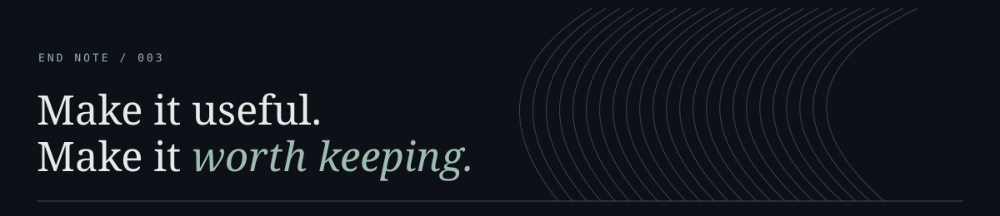

<!--
  Nibir Biswas · GitHub profile README · 2026
  Minimal dependencies: all graphics live inside /assets.
  Update project descriptions as the repositories evolve.
-->

  
   
  AI / ML RESEARCH &nbsp;·&nbsp; DEVELOPER TOOLS &nbsp;·&nbsp; OPEN SOURCE &nbsp;·&nbsp; INDEPENDENT SOFTWARE
    
  <a href="#01--a-bit-about-me">About</a> &nbsp; / &nbsp;
  <a href="#02--selected-work">Work</a> &nbsp; / &nbsp;
  <a href="#03--the-workbench">Workbench</a> &nbsp; / &nbsp;
  <a href="#05--beyond-the-terminal">Elsewhere</a> &nbsp; / &nbsp;
  <a href="https://github.com/nibir-ai?tab=repositories">All repositories ↗</a>

 

## 01 / A bit about me

**I’m Nibir. I study intelligence and build software.**

Currently pursuing an **M.Tech in Artificial Intelligence**, I work at the intersection of machine learning, practical systems, and developer experience. Some projects begin with a research question; others begin with an irritatingly repetitive task I can no longer ignore.

I'm drawn to the mechanics underneath the abstraction: how gradients propagate, how agents coordinate, how datasets fail, how good interfaces make complex things approachable. I like figuring out *why* something works, then turning that understanding into something other people can actually use.

> **A recurring idea:** the best technical work should feel rigorous under the hood and effortless in the hand.

 

  

 

## 02 / Selected work

AN OPEN SOURCE SHELF &nbsp; / &nbsp; A FEW PROJECTS THAT EXPLAIN HOW I THINK

  

<table>
  <tr>
    <td width="50%" valign="top">
      01 &nbsp; / &nbsp; DEVELOPER INFRASTRUCTURE
      <h3><a href="https://github.com/nibir-ai/relay">Relay ↗</a></h3>
      
API exploration and team communication in the same place. Built around the gap between an endpoint existing and an endpoint being genuinely ready for someone else to use.

      
API WORKFLOWS · DEVELOPER EXPERIENCE

    </td>
    <td width="50%" valign="top">
      02 &nbsp; / &nbsp; MACHINE LEARNING INFRASTRUCTURE
      <h3><a href="https://github.com/nibir-ai/datasetvision">datasetvision ↗</a></h3>
      
A local computer-vision dataset auditing CLI. Inspects anomalies, corruption, duplicates, and dataset drift before those problems silently become model problems.

      
PYTHON · COMPUTER VISION · DATA QUALITY

    </td>
  </tr>
  <tr>
    <td valign="top">
      03 &nbsp; / &nbsp; FIRST PRINCIPLES
      <h3><a href="https://github.com/nibir-ai/micro-tensor">micro-tensor ↗</a></h3>
      
A tiny automatic-differentiation engine, written to understand the math and machinery behind neural-network training rather than treating it as a magic import.

      
AUTOGRAD · DEEP LEARNING · LEARNING BY BUILDING

    </td>
    <td valign="top">
      04 &nbsp; / &nbsp; LOCAL INTELLIGENCE
      <h3><a href="https://github.com/nibir-ai/XBMind">XBMind ↗</a></h3>
      
An experiment in giving an ordinary Bluetooth speaker a local voice interface. Speech in, language model in the middle, speech out, without requiring a remote assistant.

      
VOICE · LOCAL LLMS · HUMAN-COMPUTER INTERACTION

    </td>
  </tr>
</table>

There is more on the shelf. <a href="https://github.com/nibir-ai?tab=repositories">Explore the full repository archive →</a>

  

## 03 / The workbench

WHAT I'M CURIOUS ABOUT, WHAT I'M INVESTIGATING, WHAT I'D LIKE TO MAKE BETTER

| Area | The questions that keep me interested |
| :-- | :-- |
| **Intelligent agents** | How do we build agents that are dependable, inspectable, and actually useful outside of demos? |
| **Retrieval & knowledge** | How can language models use external evidence without obscuring where an answer came from? |
| **ML fundamentals** | What happens inside the model, and what do we learn by rebuilding its parts ourselves? |
| **Developer tools** | How can a tool remove coordination overhead without replacing it with new overhead? |
| **Local-first computing** | How much intelligence and utility can we put directly on someone's machine? |

 

### A few things in the notebook

**SpectraAgent-Nd** &nbsp; RESEARCH / M.TECH  
Exploring AI-assisted interpretation of spectral data for identifying neodymium-bearing material, with a focus on making analysis more interpretable and evidence-aware.

**ConsoleShell** &nbsp; PRODUCT CONCEPT / EXPLORATION  
Exploring what a genuinely controller-native PC game launcher could feel like: a console-grade interface, designed for desktop, without sacrificing keyboard access or local ownership.

These are explorations, not claims of finished releases.

 

## 04 / Tools, not trophies

A working set, not a proficiency scoreboard.

| | |
| :-- | :-- |
| **Languages** | Python, TypeScript, Bash, SQL |
| **Machine learning** | PyTorch, NumPy, OpenCV, local model tooling |
| **Building & shipping** | Git, Docker, Linux, APIs, CLI development |
| **Currently exploring** | RAG, LangChain / LangGraph, MCP, agent architectures |

I care much more about understanding a system deeply than collecting its logo.

 

## 05 / Beyond the terminal

Away from the editor, I gravitate toward **worlds with atmosphere**: games that reward discovery, music that lingers after it ends, and stories that ask uncomfortable questions. I also write fiction, sometimes in Bengali, sometimes in English. The same instinct runs through it all: curiosity about how things feel, not just how they function.

NOW PLAYING, MORE OR LESS &nbsp; / &nbsp; RADIOHEAD · PINK FLOYD · LORD HURON  
ALWAYS RETURNING TO &nbsp; / &nbsp; STORY-RICH GAMES · STRANGE FICTION · THOUGHTFUL DESIGN

 

## 06 / A small invitation

If you're building something interesting around **machine learning, tooling, open-source software, or human-centered interfaces**, there's a good chance we'll find something to talk about.

**[Explore my work](https://github.com/nibir-ai?tab=repositories)** &nbsp; · &nbsp; **[Follow along](https://github.com/nibir-ai)**

 

  
  NB &nbsp; / &nbsp; WORK IN PROGRESS, BY DESIGN

