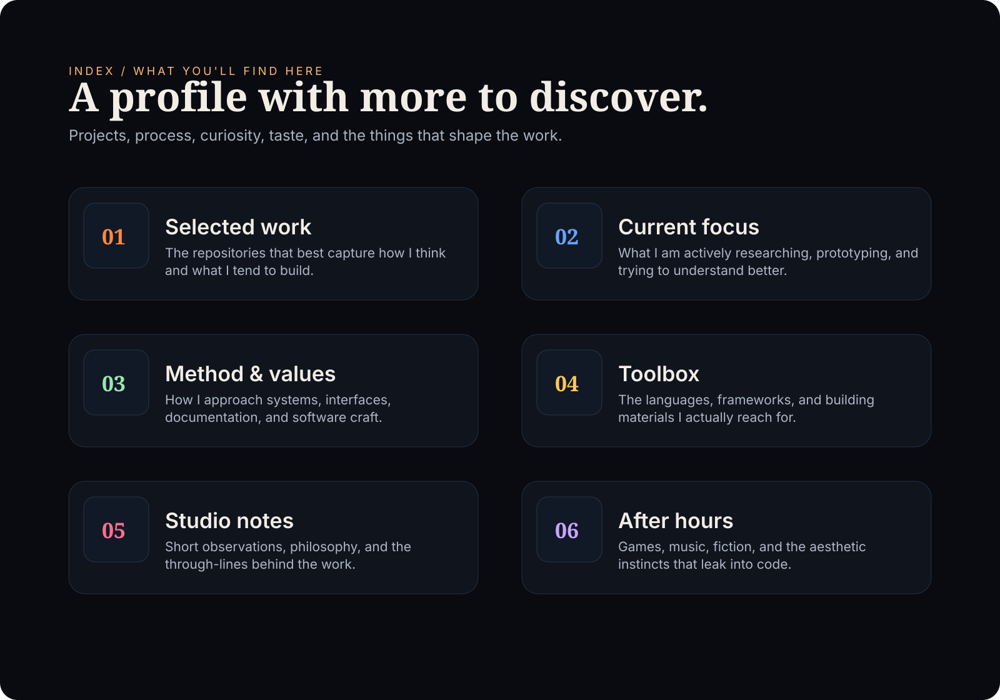
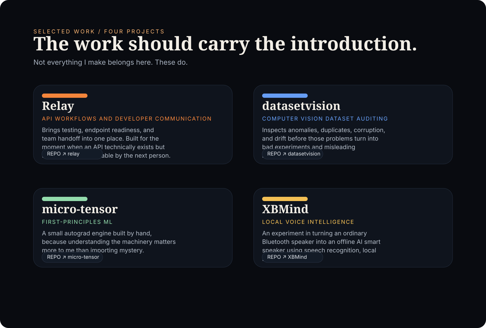
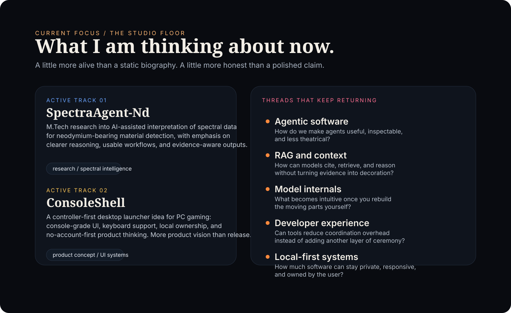
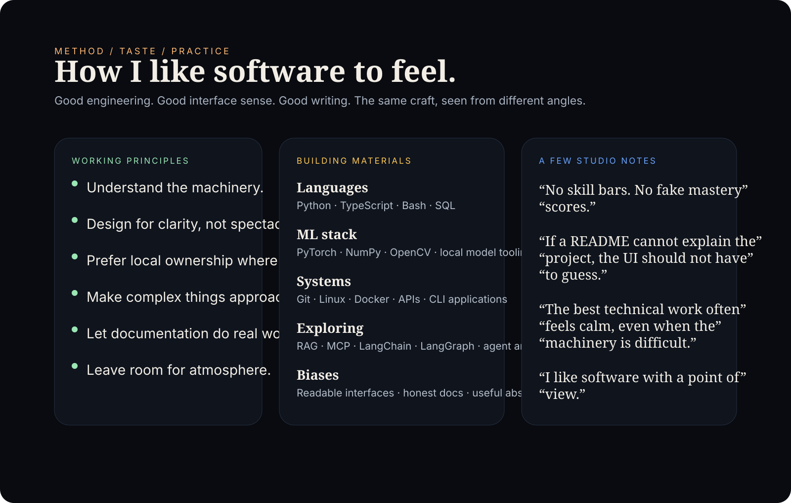
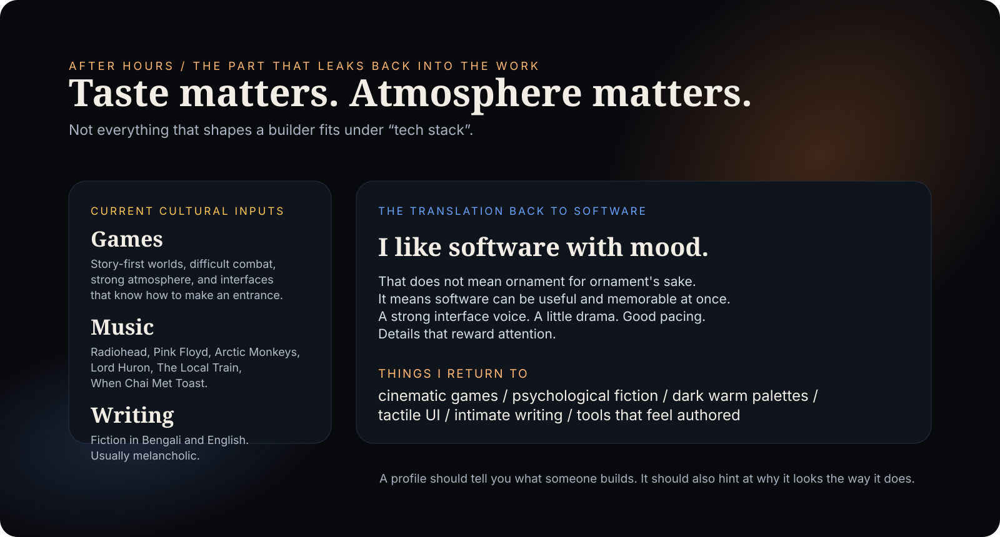
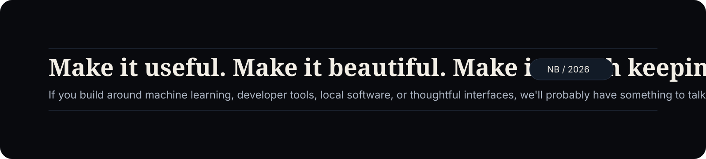

<!-- Nibir Biswas · GitHub Profile README · V4 -->

  
   
  <strong>AI / ML · DEVELOPER TOOLS · LOCAL-FIRST SOFTWARE · OPEN SOURCE</strong>
    
  <a href="#selected-work">Selected work</a> &nbsp;·&nbsp;
  <a href="#current-focus">Current focus</a> &nbsp;·&nbsp;
  <a href="#method--practice">Method</a> &nbsp;·&nbsp;
  <a href="#toolbox">Toolbox</a> &nbsp;·&nbsp;
  <a href="#after-hours">After hours</a>

 

## A small introduction

I'm **Nibir** — an M.Tech student in Artificial Intelligence, an independent builder, and someone who gets obsessed with the part underneath the abstraction.

I like making things that sit somewhere between **technical rigor** and **strong aesthetic presence**: developer tools that reduce friction, machine-learning projects that help me understand the machinery better, and product ideas that care just as much about interface feeling as implementation detail.

I don't want software to be merely functional. I want it to feel **clear**, **authored**, and **worth returning to**.

<table>
  <tr>
    <td><strong>Currently</strong></td>
    <td>M.Tech in Artificial Intelligence</td>
    <td><strong>Building</strong></td>
    <td>open-source tools, product concepts, ML experiments</td>
  </tr>
  <tr>
    <td><strong>Interested in</strong></td>
    <td>agents, retrieval, first-principles ML, local-first software</td>
    <td><strong>Care about</strong></td>
    <td>clarity, craft, interface voice, ownership</td>
  </tr>
</table>

---

## Selected work

### Project notes

| Project | Why it exists | Links |
| :-- | :-- | :-- |
| **[Relay](https://github.com/nibir-ai/relay)** | Built around a practical communication problem: an API endpoint can exist without actually being ready for the next person. Relay tries to keep testing, context, and readiness in one workflow. | `developer tools` · `API workflows` |
| **[datasetvision](https://github.com/nibir-ai/datasetvision)** | Computer-vision projects inherit the quality of their data. This project is about making problems visible before they become expensive model issues. | `Python` · `CV` · `data quality` |
| **[micro-tensor](https://github.com/nibir-ai/micro-tensor)** | A compact autograd engine made to understand neural-network training by building the machinery directly instead of only importing it. | `autograd` · `from scratch` |
| **[XBMind](https://github.com/nibir-ai/XBMind)** | An experiment in local intelligence: turning an ordinary Bluetooth speaker into an offline AI smart speaker with local STT, LLM, and TTS. | `voice` · `local AI` |

Selected, not exhaustive. You can explore the rest of the shelf in <a href="https://github.com/nibir-ai?tab=repositories">all repositories ↗</a>.

---

## Current focus

### Ongoing tracks

**SpectraAgent-Nd**  
My M.Tech research project, centered on AI-assisted analysis of spectral data to help identify neodymium-bearing material. The part that most interests me is not only whether the system is accurate, but whether its reasoning can be made more legible and useful.

**ConsoleShell**  
A product concept for a controller-first PC launcher that treats desktop gaming with console-grade seriousness while preserving keyboard support, local ownership, and no-account-first product thinking.

### Questions I keep returning to

- How do we build **agentic systems** that are actually inspectable and not just impressive in demos?
- How should **retrieval and context** support reasoning instead of becoming decorative citations?
- What becomes easier to understand when you rebuild **ML internals** from first principles?
- Can a tool remove **coordination overhead** instead of simply moving it around?
- How much capability can stay **local-first, private, and responsive**?

---

## Method & practice

I like the meeting point of engineering discipline and authored experience.

That usually means:
- understanding the machinery well enough to explain it plainly
- giving interfaces a real voice instead of flattening everything into generic utility
- preferring honest documentation over decorative complexity
- caring about what the user feels in the first ten seconds, not just whether the software works by minute ten

A lot of what I value can be summarized simply: **small understandable cores, visible assumptions, useful writing, and software with atmosphere**.

---

## Toolbox

### Languages & foundations
`Python` `TypeScript` `Bash` `SQL`

### ML & data
`PyTorch` `NumPy` `OpenCV` `local model tooling`

### Systems & development
`Git` `Linux` `Docker` `REST APIs` `CLI apps`

### Currently exploring
`RAG` `MCP` `LangChain` `LangGraph` `agent architectures`

No fake proficiency meters. No inflated percentages. Just the materials I tend to use.

---

## Studio notes

> I like software with a point of view.

> I think the best technical work often feels calmer than the machinery underneath it.

> A README is part of the product.

> Good interfaces are not decoration. They are interpretation.

> Utility does not have to be emotionally flat.

---

## After hours

The work is shaped by things outside the editor too.

I gravitate toward **story-rich games**, **melancholic music**, **psychological and speculative fiction**, and interfaces that know how to create a little drama. I also write fiction in **Bengali** and **English**, which is probably part of why I care so much about texture and mood even in technical spaces.

### Always nearby
- **Music:** Radiohead, Pink Floyd, Arctic Monkeys, Lord Huron, The Local Train, When Chai Met Toast
- **Games:** story-first experiences, difficult combat, tactile interfaces, strong atmosphere
- **Writing:** fiction, introspection, human tension, a little darkness

---

  <a href="https://github.com/nibir-ai?tab=repositories"><strong>Explore the repositories ↗</strong></a>
  &nbsp;·&nbsp;
  <a href="https://github.com/nibir-ai"><strong>Follow the work ↗</strong></a>
    
  NB / this profile is designed as an evolving space, not a finished monument.

