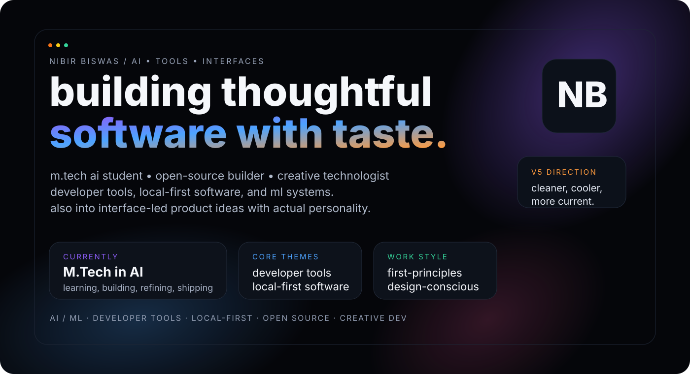
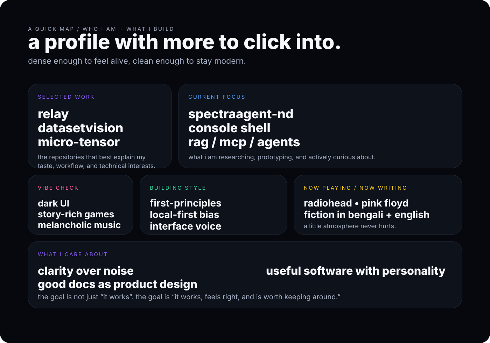
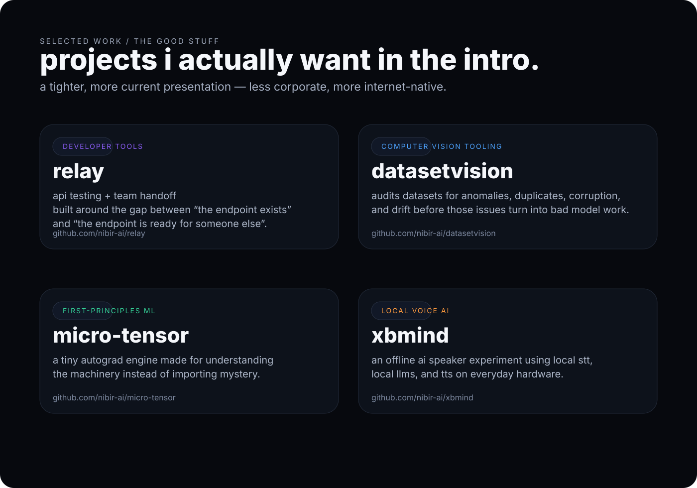
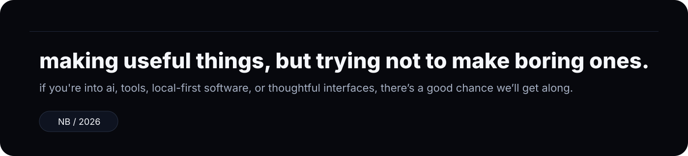

<!-- github profile v5 -->

  
   
  
    <strong>AI / ML</strong> &nbsp;·&nbsp;
    <strong>DEVELOPER TOOLS</strong> &nbsp;·&nbsp;
    <strong>LOCAL-FIRST SOFTWARE</strong> &nbsp;·&nbsp;
    <strong>OPEN SOURCE</strong>
  
    
  <a href="#selected-work">selected work</a> &nbsp;·&nbsp;
  <a href="#right-now">right now</a> &nbsp;·&nbsp;
  <a href="#toolkit">toolkit</a> &nbsp;·&nbsp;
  <a href="#beyond-code">beyond code</a>

 

## about

i’m **Nibir** — an **M.Tech student in Artificial Intelligence**, an open-source builder, and someone who likes software that feels both **technically solid** and **visually intentional**.

Most of what I make lives somewhere around:
- developer tools
- local-first software
- machine learning systems
- product ideas where interface quality actually matters

I like understanding the machinery beneath the abstraction, but I also care about how the final thing feels in the hand.

---

## selected work

### project notes

| project | what it’s about | link |
| :-- | :-- | :-- |
| **relay** | an API workflow tool built around the gap between an endpoint existing and an endpoint being genuinely ready for the next person. | [repo ↗](https://github.com/nibir-ai/relay) |
| **datasetvision** | a local CV dataset auditing CLI for spotting anomalies, duplicates, corruption, and drift before training time becomes waste. | [repo ↗](https://github.com/nibir-ai/datasetvision) |
| **micro-tensor** | a tiny autograd engine made to understand neural-network training from first principles. | [repo ↗](https://github.com/nibir-ai/micro-tensor) |
| **XBMind** | an offline AI smart-speaker experiment using local speech recognition, local LLMs, and TTS. | [repo ↗](https://github.com/nibir-ai/XBMind) |

there’s more in the archive — these are just the ones i want doing the introduction work.

---

## right now

### active threads
- **SpectraAgent-Nd** — my M.Tech research project around AI-assisted interpretation of spectral data for neodymium-bearing material detection.
- **ConsoleShell** — a controller-first PC launcher concept with console-grade feel, proper keyboard support, and local ownership.
- **RAG / MCP / agents** — especially the part where these systems become more useful, inspectable, and less demo-shaped.

### what i care about
- clarity over noise
- local-first bias
- strong docs
- interface voice
- useful software with personality

---

## toolkit

### languages
`Python` `TypeScript` `Bash` `SQL`

### ML + data
`PyTorch` `NumPy` `OpenCV` `local model tooling`

### systems
`Linux` `Git` `Docker` `REST APIs` `CLI apps`

### currently exploring
`RAG` `LangChain` `LangGraph` `MCP` `agents`

---

## studio notes

> good software doesn’t have to feel emotionally flat.

> i like tools that are clear, opinionated, and worth keeping around.

> docs are part of the product.

> the best interfaces usually feel effortless, even when the machinery underneath definitely is not.

---

## beyond code

i’m into **story-rich games**, **melancholic music**, **fiction**, and interfaces with mood.

That part leaks back into the work more than i’d pretend otherwise.

### always nearby
- **music:** Radiohead, Pink Floyd, Arctic Monkeys, Lord Huron, The Local Train, When Chai Met Toast
- **games:** cinematic stuff, difficult combat, tactile UI, atmosphere-heavy worlds
- **writing:** fiction in Bengali and English, usually introspective and a little dark

---

  <a href="https://github.com/nibir-ai?tab=repositories"><strong>explore repositories ↗</strong></a>
  &nbsp;·&nbsp;
  <a href="https://github.com/nibir-ai"><strong>follow profile ↗</strong></a>

